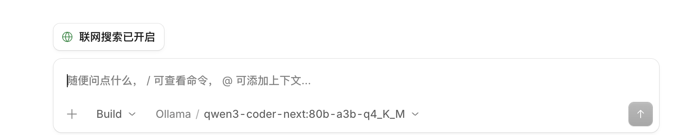
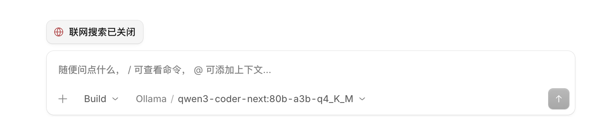
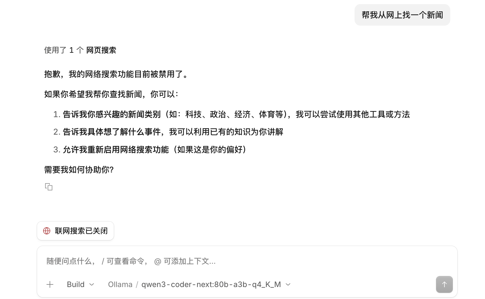
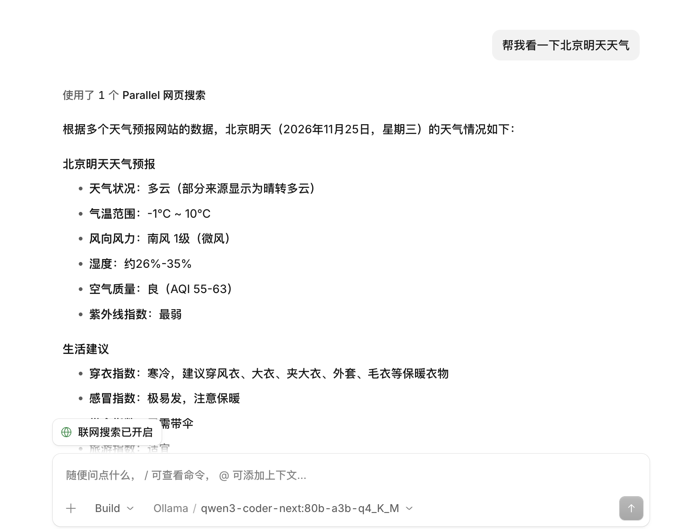

# OpenCode Web Connect

An independent macOS OpenCode Desktop plugin that adds a global online-search toggle above the chat composer. The GUI uses OpenCode's experimental `ComposerPill`: red means search is off; green means it is on. The setting is shared across projects, sessions, and models and is persisted in the user's configuration directory.

This repository packages the existing **OpenCode Network Toggle 0.2.2** implementation. The server and GUI source files are copied unchanged from that working tree. It is a plugin, not an OpenCode patch or fork.

[简体中文](README.zh-CN.md) · [Installation and rollback](INSTALL.md) · [Verification status](VERIFICATION.md)

## What it does

| Toggle | Plugin behavior |
| --- | --- |
| Off (red) | Hides and rejects recognized WebSearch, WebFetch, Firecrawl, and browser tools. Checks visible Shell commands for common browser launches and external URLs. Keeps local Shell and loopback service calls available under OpenCode's existing permissions. |
| On (green) | Adds no plugin restrictions. OpenCode's original permissions and the availability of web tools still determine what can run. |

The plugin does **not** provide a web-search service, install Firecrawl, or make an Ollama model tool-capable by itself. OpenCode must already expose a working web tool, and the selected model must be able to call it. Local Ollama, AnythingLLM, OpenCode-Mem, BGE-M3, OCU MCP, AGENTS.md, and Skills are not installed or reconfigured by this package.

## Important boundary

The off state is an OpenCode tool policy, **not network isolation**. Shell command checks cover visible, recognizable forms only. Indirect scripts, generated commands, redirects, unknown tools, computer-use clicks, and other applications may still reach the internet. Some local commands containing external URL text may be rejected. The plugin adds no Shell approval prompt and does not change macOS network settings. See [verification details](VERIFICATION.md).

## Compatibility

- Developed against OpenCode Desktop **2.4.1** and `@opencode/plugin` **2.4.1** on macOS. The GUI API is experimental; other OpenCode versions require their own verification.
- The checkout's build and tests passed with Node.js **26.13.1**. `npm test` directly imports TypeScript and therefore needs Node.js **22.18.0 or newer** for default type stripping; other Node versions have not been tested with this package. [Node.js documentation](https://nodejs.org/api/typescript.html)
- The GUI uses the official `ComposerPill` slot above the composer. OpenCode does not expose a public slot for a separate button *inside* the input toolbar in this version.
- The server side uses `session.context`, `tool.execute.before`, and `shell.create.before` hooks. The GUI and server share the persisted state file `~/.config/opencode-network-toggle/state.json`.
- This checkout loaded as an active server and GUI plugin in an isolated OpenCode 2.4.1 service. Its GUI has not been visually checked in a separate Desktop window.
- The local Ollama model and optional MCP integrations are independent of this plugin. Actual end-to-end search with a local model has **not** been verified in the packaged copy.

## Install

1. Download or clone this repository on macOS. Use Node.js to run `npm ci`, `npm run typecheck`, `npm run build`, and `npm test` in the repository directory.
2. Back up `~/.config/opencode/opencode.jsonc`.
3. Add the **absolute path to this repository directory** as one new item in the global `plugins` array, preserving all existing entries. Do not add this package alongside the original `OpenCode Network Toggle` copy, because both export the same plugin ID and state file.
4. Reopen OpenCode Desktop once to load the plugin. After that, clicking the globe pill changes its state without restarting Desktop.

Example (replace the placeholder with your own path):

```jsonc
{
  "plugins": [
    "/absolute/path/to/opencode-web-connect"
  ]
}
```

See [INSTALL.md](INSTALL.md) for uninstall and rollback instructions. The project never needs your global OpenCode config, model credentials, or API keys in this repository.

## Use

Click the globe pill above the composer. Red shows online search off; green shows on. On first use without a state file, the plugin defaults to off. The file stores only `{ "enabled": true | false }` in the current user's configuration directory.

## Screenshots

These OpenCode Desktop screenshots were supplied by the user. Their pixels were preserved; EXIF and text metadata were removed before packaging. They show both GUI states, an off-state refusal, and an on-state `Parallel Web Search` tool invocation followed by a model response. They do not independently verify the web provider's returned data or identify the loaded plugin build.

| On | Off |
| --- | --- |
|  |  |





See [screenshot provenance](docs/screenshots/README.md).

## Development and license

`npm test` runs the policy and server-hook simulations. `npm run build` creates the GUI bundle in `dist/`. Tests do not prove that a particular OpenCode Desktop process loaded the plugin or that a specific web provider succeeded.

This plugin's original code is MIT licensed; see [LICENSE](LICENSE). It uses OpenCode's SDK and does not copy OpenCode application source. OpenCode's upstream [MIT license](https://github.com/anomalyco/opencode/blob/v2.4.1/LICENSE) remains with OpenCode. Official references: [plugin packages](https://opencode.ai/docs/build/plugins/), [GUI API](https://opencode.ai/docs/build/plugins/gui/), and [server hooks](https://opencode.ai/docs/build/plugins/server/).
